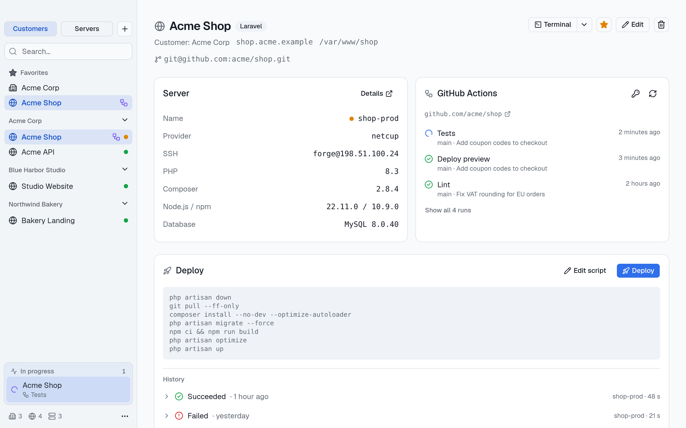
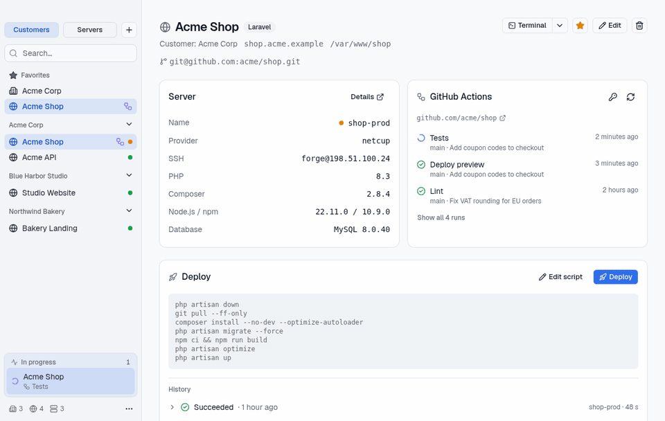

# Hostmoor

[English](README.md) · **Deutsch**

**Alle Server und Kundenprojekte in einer Desktop-App.** Hostmoor ist für Freelancer und kleine Agenturen, die Laravel- und WordPress-Seiten auf eigenen Servern und auf Kundenservern betreiben (Hetzner, netcup, IONOS …): sehen, was wo läuft, Server prüfen, deployen und CI im Blick behalten, ohne SaaS-Konto und ohne SSH-Keys herauszugeben.

Läuft unter macOS, Windows und Linux, auf Englisch und Deutsch.

Früher StackPort. Wie du deine Daten aus StackPort mitnimmst, steht im [Changelog](CHANGELOG.md#110---2026-11-09).



## Funktionen

- **Kunden → Projekte → Server**, in der Seitenleiste nach Kunden oder nach Servern gruppiert, mit Favoriten und Suche
- **Server-Check** auf Knopfdruck: Betriebssystem, CPU, RAM, Platten, PHP mit Erweiterungen, Composer, Node/npm, Git, WP-CLI, Webserver, Datenbank, Redis. Das Skript ([`check.sh`](src-tauri/src/check.sh)) liest nur; das Ergebnis wird lokal gespeichert und nach 30 Tagen als veraltet markiert
- **Verbindungstest mit Einrichtungshilfe**: Hostmoor erkennt die Ursache (unbekannter Host, Key abgelehnt, falsche Rechte, Firewall …) und zeigt die passenden Befehle für dein System
- **Deploys** pro Projekt: Vorlagen für Laravel und WordPress, Bestätigung vor jedem Start, Live-Ausgabe, Abbrechen, Verlauf der letzten 20 Deploys, Systemmitteilung am Ende
- **GitHub Actions und GitLab-Pipelines** pro Projekt (auch selbst gehostetes GitLab), im Hintergrund abgefragt, mit Mitteilung bei Start, Erfolg und Fehlschlag
- **SSL-Zertifikate im Blick** je Projekt-Domain: Ablaufdatum, Aussteller und HTTP-Status, alle 6 Stunden geprüft, mit Mitteilung 14 und 3 Tage vor Ablauf oder bei ungültigem Zertifikat
- **Import aus `~/.ssh/config`**: Hosts aus der SSH-Konfiguration (inklusive `Include`-Dateien) auswählen und als Server anlegen; vorhandene Server werden erkannt, die Datei wird nur gelesen
- **Jump-Hosts** (`ProxyJump`): Server hinter einem Bastion-Host funktionieren für Prüfung, Deploy, Logs und Terminal
- **Log-Viewer** pro Projekt: Laravel-, WordPress-, nginx- oder PHP-Logs per SSH lesen, nach Warnungen und Fehlern filtern, durchsuchen und neue Zeilen live mitlesen; nur lesend, auf dem Server wird nichts verändert
- **Terminal-Knopf**: öffnet eine SSH-Sitzung in deinem Terminal, bei Projekten direkt im Projektordner
- **Backup** aller Daten als JSON, Export und Wiederherstellung



## Installation

Den Installer für dein System gibt es auf der [Release-Seite][releases]: `.dmg` für macOS, `.msi` oder `-setup.exe` für Windows, `.AppImage`, `.deb` oder `.rpm` für Linux.

Die Apps sind nicht signiert, dein System warnt deshalb einmal:

- **macOS:** Gatekeeper meldet, Hostmoor sei „beschädigt“ oder „nicht verifiziert“. Nachdem du die App in den Programme-Ordner gezogen hast, entfernst du die Quarantäne-Markierung einmal im Terminal:

  ```bash
  xattr -cr /Applications/Hostmoor.app
  ```

- **Windows:** SmartScreen meldet „Der Computer wurde durch Windows geschützt“. „Weitere Informationen“ → „Trotzdem ausführen“ wählen.
- **Linux:** das AppImage ausführbar machen (`chmod +x Hostmoor_*.AppImage`) oder das Paket installieren.

Zu jedem Release gehört eine `SHA256SUMS.txt`. Zum Prüfen eines Downloads im Download-Ordner `shasum -a 256 -c SHA256SUMS.txt --ignore-missing` (macOS) oder `sha256sum -c SHA256SUMS.txt --ignore-missing` (Linux) ausführen.

Hostmoor nutzt den `ssh`-Client des Systems, unter Windows den OpenSSH-Client von Windows 10 und 11.

## Sicherheit und Datenschutz

- **Nur lokal.** Alle Daten liegen in einer SQLite-Datenbank auf deinem Rechner. Kein Konto, keine Cloud, keine Telemetrie.
- **Signierte Updates, nur mit deiner Zustimmung.** Beim Start sucht Hostmoor auf GitHub nach einer neuen Version und fragt vor der Installation. Updates werden gegen einen öffentlichen Schlüssel in der App geprüft, ein manipulierter Download wird abgelehnt.
- **SSH-Keys werden nie gelesen.** Hostmoor speichert nur den *Pfad* zum Key und übergibt ihn an `ssh -i`.
- **Kein stilles Vertrauen in Hosts.** Checks und Deploys laufen mit `BatchMode=yes` und `StrictHostKeyChecking=yes`.
- **Tokens im Schlüsselbund des Systems**, nie in der Datenbank oder im Backup.

Sicherheitslücken bitte vertraulich melden, siehe [SECURITY.md](SECURITY.md).

Entwicklung und Roadmap stehen im [englischen README](README.md).

## Lizenz

[GNU Affero General Public License v3.0](LICENSE) (`AGPL-3.0-only`).

<!-- Repo-Links: nur hier ändern, wenn das Repo umzieht -->
[releases]: https://github.com/seprylabs/hostmoor/releases
