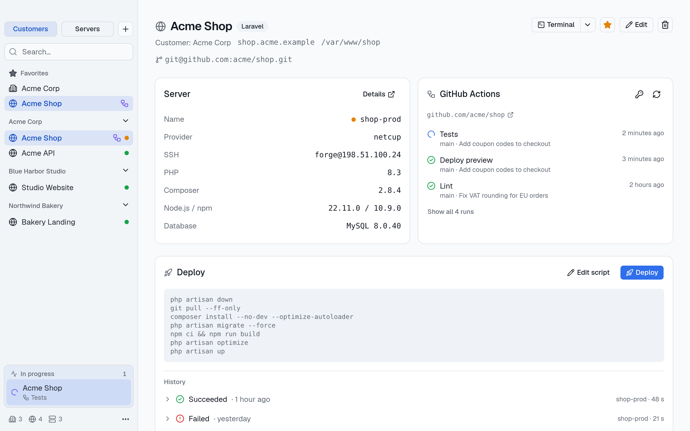
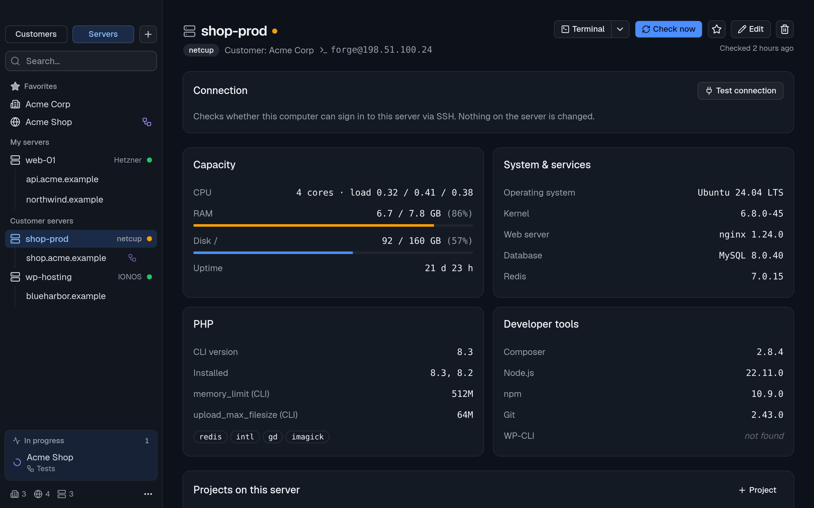
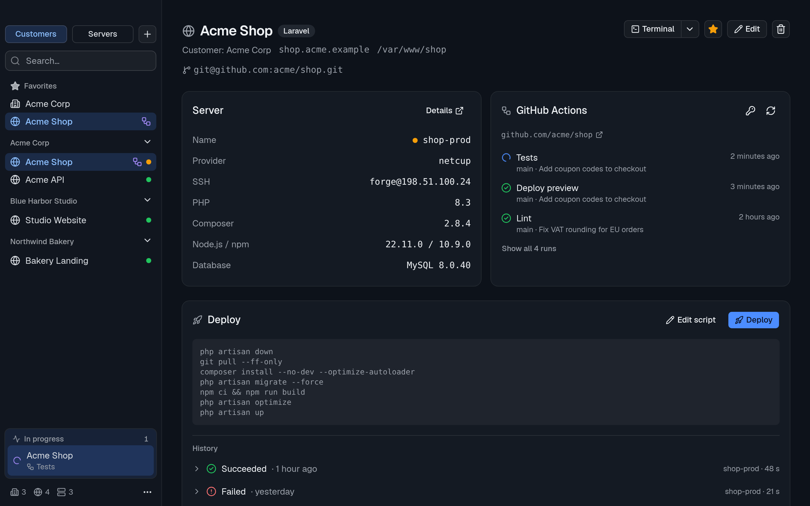
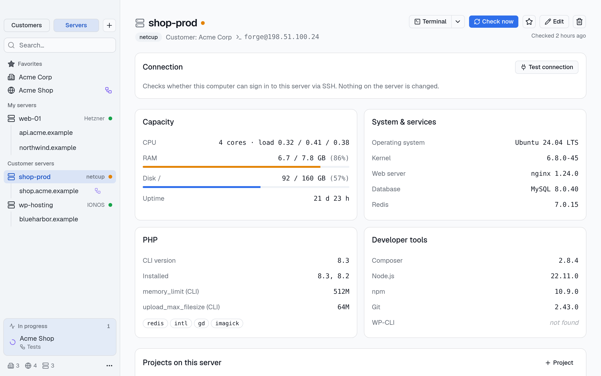
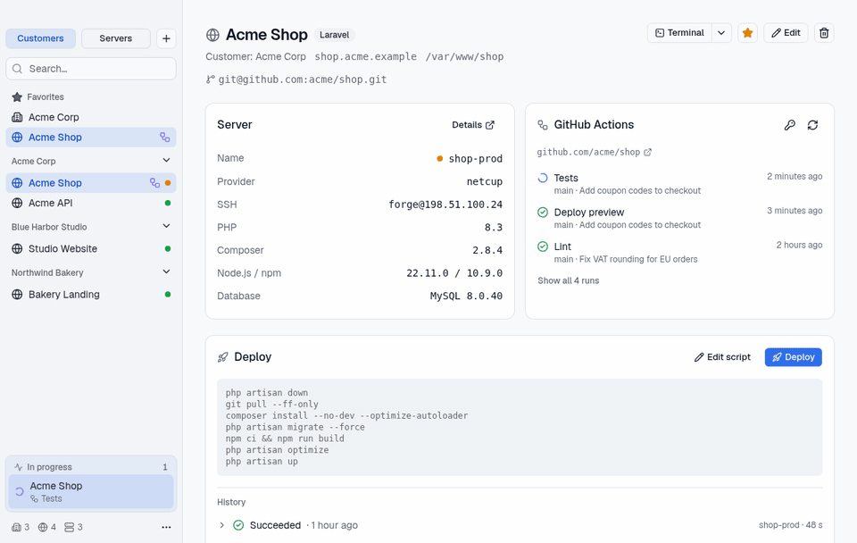

# StackPort

**English** · [Deutsch](README.de.md)

[![CI][ci-badge]][ci] [![Release][release-badge]][releases] [![License: AGPL-3.0][license-badge]](LICENSE)

**All your servers and client projects in one desktop app.** StackPort is for freelancers and small agencies who run Laravel and WordPress sites on their own and their clients' servers (Hetzner, netcup, IONOS …): see what runs where, check servers, deploy, and watch CI, without a SaaS account and without handing out SSH keys.

Runs on macOS, Windows and Linux. English and German.



<details>
<summary>More screenshots</summary>





</details>

## Features

- **Customers → projects → servers**, grouped in the sidebar by customer or by server, with favorites and search
- **Server check** on demand: OS, CPU, RAM, disks, PHP and extensions, Composer, Node/npm, Git, WP-CLI, web server, database, Redis. The script ([`check.sh`](src-tauri/src/check.sh)) only reads; results are stored locally and marked as outdated after 30 days
- **Connection test with setup help**: StackPort recognizes the cause (unknown host, key not accepted, wrong permissions, firewall …) and shows the commands to fix it for your system
- **Deploys** per project: templates for Laravel and WordPress, confirmation before every run, live output, cancel, history of the last 20 deploys, system notification when done
- **GitHub Actions and GitLab pipelines** per project (including self-hosted GitLab), polled in the background with a notification on start, success and failure
- **Terminal button**: opens an SSH session in your terminal (Terminal, iTerm2, Ghostty, WezTerm, GNOME Terminal, Konsole, Windows Terminal …), for projects right in the project folder
- **Backup** of all data as JSON, export and restore



## Installation

Download the installer for your system from the [releases page][releases]:

| System | File |
| --- | --- |
| macOS (Apple Silicon and Intel) | `.dmg` |
| Windows 10 and 11 | `.msi` or `-setup.exe` |
| Linux | `.AppImage`, `.deb` or `.rpm` |

The apps are not code-signed, so your system will warn once:

- **macOS:** Gatekeeper reports that StackPort “is damaged” or “cannot be verified”. After moving the app to Applications, run this once in Terminal to remove the quarantine flag:

  ```bash
  xattr -cr /Applications/StackPort.app
  ```

- **Windows:** SmartScreen shows “Windows protected your PC”. Choose “More info” → “Run anyway”.
- **Linux:** make the AppImage executable (`chmod +x StackPort_*.AppImage`) or install the package.

Each release includes `SHA256SUMS.txt`. To verify a download, run `shasum -a 256 -c SHA256SUMS.txt --ignore-missing` (macOS) or `sha256sum -c SHA256SUMS.txt --ignore-missing` (Linux) in the download folder.

StackPort uses the `ssh` client of your system. On Windows this is the OpenSSH client that ships with Windows 10 and 11.

## Security and privacy

StackPort has SSH and deploy access to your servers, so it is built to need as little trust as possible:

- **Local only.** All data stays in a SQLite database on your computer. No account, no cloud, no telemetry. The only network requests go to your servers (via `ssh`) and to the GitHub or GitLab API for pipelines.
- **SSH keys are never read.** StackPort stores only the *path* to a key and passes it to `ssh -i`. Passphrases stay in your SSH agent or keychain.
- **No silent host trust.** Checks and deploys run with `BatchMode=yes` and `StrictHostKeyChecking=yes`. New or changed host keys are never accepted automatically.
- **Tokens in the system keychain.** CI tokens are stored in the macOS Keychain, the Windows Credential Manager or the Secret Service on Linux, never in the database or in backups.
- **Strict content security policy** and minimal Tauri permissions.

Found a vulnerability? Please report it privately, see [SECURITY.md](SECURITY.md).

## Scope

StackPort does not provision servers. It is the overview and toolbox for servers that already exist, including client servers where you only have SSH access.

## Roadmap

- Automatic updates
- Homebrew, winget and Flathub/AUR packages
- Rollback for deploys, more deploy templates

## Development

Requirements: Rust (`rustup`), Node 22 (see `.nvmrc`) and the [Tauri prerequisites](https://v2.tauri.app/start/prerequisites/) for your system: Xcode Command Line Tools (macOS), Microsoft C++ Build Tools and WebView2 (Windows), or `libwebkit2gtk-4.1-dev` and friends (Linux).

```bash
npm install
npm run tauri dev      # run the app with hot reload
npm run tauri build    # build installers → src-tauri/target/release/bundle/
cd src-tauri && cargo test
```

Without Tauri the UI also runs in the browser (`npm run dev`, http://localhost:1420); data is then kept in localStorage instead of SQLite.

The database `stackport.db` lives in the app data folder `de.spmedia.stackport`: `~/Library/Application Support/` on macOS, `%APPDATA%` on Windows, `~/.local/share/` on Linux. Schema migrations are in [`db.rs`](src-tauri/src/db.rs) and run on startup.

```
src/                    React UI (React 19, TypeScript, Tailwind CSS 4, shadcn/ui)
  locales/              English and German texts
  lib/api.ts            calls into the Rust backend, with browser fallback
src-tauri/src/
  db.rs                 SQLite, migrations
  ssh.rs                system ssh, error detection
  check.rs, check.sh    server check
  deploy.rs             deploys with live output
  ci.rs, ci_watch.rs    GitHub/GitLab API, background polling
  terminal.rs           terminal apps per platform
```

## Contributing

Bug reports, ideas and pull requests are welcome. See [CONTRIBUTING.md](CONTRIBUTING.md) and the [Code of Conduct](CODE_OF_CONDUCT.md). Changes are listed in the [changelog](CHANGELOG.md).

## License

StackPort is licensed under the [GNU Affero General Public License v3.0](LICENSE) (`AGPL-3.0-only`). Built by [SPMedia](https://spmedia.de).

Check the licenses of dependencies:

```bash
cd src-tauri && cargo deny check licenses                 # Rust (cargo install cargo-deny)
npx license-checker-rseidelsohn --production --summary   # npm
```

<!-- Repository links: change only here when the repository moves -->
[ci]: https://github.com/seprylabs/stackport/actions/workflows/ci.yml
[ci-badge]: https://github.com/seprylabs/stackport/actions/workflows/ci.yml/badge.svg
[releases]: https://github.com/seprylabs/stackport/releases
[release-badge]: https://img.shields.io/github/v/release/seprylabs/stackport
[license-badge]: https://img.shields.io/badge/license-AGPL--3.0-blue
